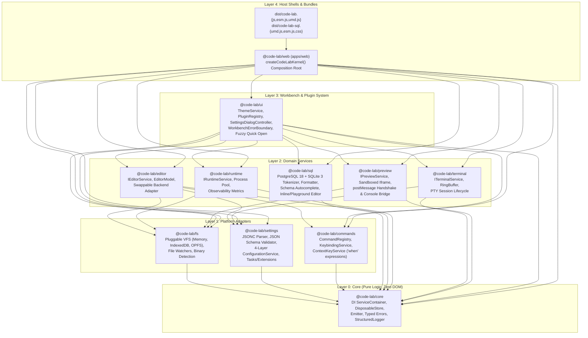
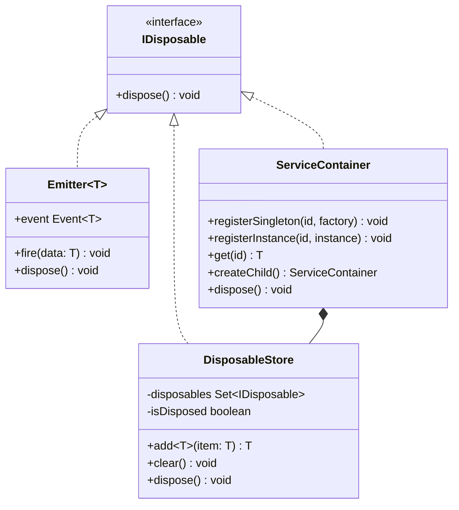
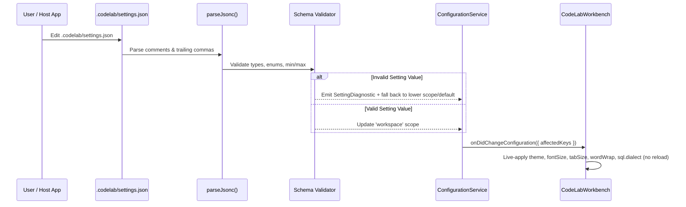

# `@innovatorved/code-lab` Architecture (v0.4.0)

`@innovatorved/code-lab` is a modular, strict-TypeScript, open-source browser IDE core, POSIX virtual execution environment, and first-class SQL playground (`@innovatorved/code-lab/sql`). It runs entirely client-side with zero server dependencies and zero mandatory `COOP`/`COEP` headers.

---

## 1. Layered Package DAG (Monorepo Architecture)

Code-Lab enforces a strict **4-layer one-way Dependency Acyclic Graph (DAG)** across 11 Bun workspaces (`packages/*` and `apps/*`), verified on every build and CI run by [`tools/check-boundaries.js`](../tools/check-boundaries.js):

### Layer Rules Enforced by `tools/check-boundaries.js`
1. **`core` (`Layer 0`)**: Pure TypeScript. No DOM globals (`window`, `document`, `HTMLElement`) and zero imports from upper layers.
2. **`platform` (`Layer 1`: `fs`, `settings`, `commands`)**: Depends only on `@code-lab/core` (and peer platform contracts where explicitly allowed).
3. **`services` (`Layer 2`: `sql`, `editor`, `runtime`, `terminal`, `preview`)**: Depends only on `core` and `platform`. `@code-lab/sql` is deliberately self-contained so `@innovatorved/code-lab/sql` ships at **~16.5 KB gzipped** (JS + CSS combined, `< 35 KB` budget) with zero WASM or Monaco/CodeMirror overhead.
4. **`ui` (`Layer 3`)**: Composes `core`, `platform`, and `services` into themes, declarative plugin contributions, `<dialog>` settings UI, fuzzy file navigation, and error boundaries.
5. **`apps/web` (`Layer 4`)**: Instantiates the `CodeLabKernel` DI container and connects to `CodeLabWorkbench` (`src/workbench.ts`).
6. **Public API Encapsulation**: Cross-package imports must target `@code-lab/<pkg>` (`src/index.ts`) — deep imports into another package's internal files fail `bun run check:boundaries`.

---

## 2. Dependency Injection & Disposable Lifecycle

Every service and event subscription follows VS Code's `IDisposable` discipline to prevent listener, timer, Blob URL, and Worker leaks across repeated `.mount()` / `.destroy()` cycles:

- **Cycle Detection**: `ServiceContainer.get(id)` tracks the active resolution stack and throws a `CircularDependencyError` (`E_DI_CYCLE`) with the exact dependency chain (`A -> B -> A`) if a cycle is introduced.
- **Leak Auditing**: `setGlobalEventMonitor()` in `@code-lab/core` instruments every `Emitter` subscription/disposal so unit tests and the Workbench **Observability** drawer can assert zero orphaned listeners on teardown.

---

## 3. Configuration Cascade & `.codelab/` Workspace Protocol

`ConfigurationService` (`@code-lab/settings`) merges settings across four priority scopes (`default < user < workspace < override`) and validates values against registered JSON Schemas:

### Supported `.codelab/` Workspace Files
| File | Purpose |
| --- | --- |
| `.codelab/settings.json` | JSONC workspace overrides (`editor.fontSize`, `editor.tabSize`, `editor.wordWrap`, `workbench.theme`, `sql.dialect`, `runtime.timeoutMs`, etc.). |
| `.codelab/keybindings.json` | Chord bindings (`{ "key": "Mod+Shift+P", "command": "...", "when": "editorFocus" }`) and `-command` unbinding rules. |
| `.codelab/tasks.json` | Named shell/runtime tasks (`build`, `test`, `dev`), including `"runOn": "folderOpen"` startup tasks. |
| `.codelab/extensions.json` | Workspace-recommended plugin IDs (`{ "recommendations": [...] }`) auto-activated by `PluginRegistry`. |

---

## 4. First-Class SQL Architecture (`@innovatorved/code-lab/sql`)

Designed for interactive learning platforms (`sql-in-depth`) and data sandboxes, `@code-lab/sql` provides three progressive mount surfaces without bundling heavy third-party editors or SQL WASM engines:

1. **`mode: 'inline'` (`createSqlEditor`)**: Ultra-lightweight auto-growing SQL block (`minLines`..`maxLines`) with line numbers, `PostgreSQL 18` / `SQLite 3` syntax highlighting, schema-aware autocomplete, and `Cmd/Ctrl+Enter` execution — safe to mount 5–10 instances on a single lesson page.
2. **`mode: 'playground'` (`createSqlEditor`)**: Responsive split/stacked SQL studio (`font-size >= 16px` on coarse pointers to prevent iOS Safari zoom-on-focus) with pluggable results/schema/`EXPLAIN` slots.
3. **`mode: 'workbench'` (`CodeLab.mount({ lang: 'sql', sqlRunner, steps })`)**: Full Guided Lab IDE shell with step verification, hints, solution diff, custom `sqlRunner` injection (e.g., PGlite / sql.js Web Worker), built-in `SqliteDatabase` fallback, inline wavy error diagnostics (`parseSqlEngineError`), and automatic hiding of irrelevant multi-file/POSIX-shell chrome when single-file SQL is mounted.

---

## 5. Runtime, POSIX Shell, PTY Terminal & Preview Sandboxing

- **Execution Engine (`src/runtime.ts` + `@code-lab/runtime`)**:
  - Warm Web Worker pool with hard `worker.terminate()` timeout preemption, 50 Node.js v22 built-in module shims, Bun v1.1 (`Bun.serve`, `bun:sqlite`, `bun:test`), WASI Preview 1 C++20, and Python 3.12 extensions.
  - `VirtualPortTable` routes loopback HTTP/TCP traffic in-memory across `http.createServer`, `Bun.serve`, `fetch`, and `curl`.
- **POSIX Shell & PTY (`src/shell.ts`, `src/terminal.ts`, `@code-lab/terminal`)**:
  - Recursive-descent AST parser with pipelines, redirects, job control (`jobs`, `fg`, `bg`, `kill`), 71 built-in coreutils (`git`, `jq`, `sqlite3`, `awk`, `sed`, `grep`, `hey`, `chaos`), and bounded `RingBuffer` output backpressure.
- **Sandboxed Web Preview (`@code-lab/preview` + `dist/preview-sw.js`)**:
  - Runs untrusted user HTML/JS inside a restricted `sandbox="allow-scripts allow-forms allow-modals"` iframe (never combining `allow-scripts` + `allow-same-origin` on the host origin), authenticating `postMessage` frames via per-session cryptographic nonces and strict origin checks.

---

## 6. Build Artifacts (`bun run build`)

| Bundle | Format | Description |
| --- | --- | --- |
| `dist/code-lab.js` / `.esm.js` / `.umd.js` | CJS / ESM / UMD | Full IDE Workbench + Virtual Runtime + POSIX Shell + PTY + Modular Kernel + SQL Pack |
| `dist/code-lab-sql.umd.js` / `.esm.js` / `.css` | UMD / ESM / CSS | Standalone lightweight SQL Playground & Inline Editor (`< 35 KB` gzipped combined) |
| `dist/runtime.js` / `.esm.js` | CJS / ESM | Headless Node.js v22 + Bun v1.1 Virtual Runtime |
| `dist/shell.js` / `.esm.js` | CJS / ESM | Standalone POSIX Shell + 71 Coreutils |
| `dist/terminal.js` / `.esm.js` | CJS / ESM | Standalone ANSI/VT100 PTY Terminal Engine |
| `dist/extensions/*.{js,esm.js,d.ts}` | IIFE / ESM | Opt-in extensions (`guided-lab`, `javascript`, `typescript`, `cpp`, `python`) |
| `dist/code-lab.css` | CSS | Theme tokens (Dark, Light, High Contrast), `<dialog>` Settings UI, responsive SQL results |
