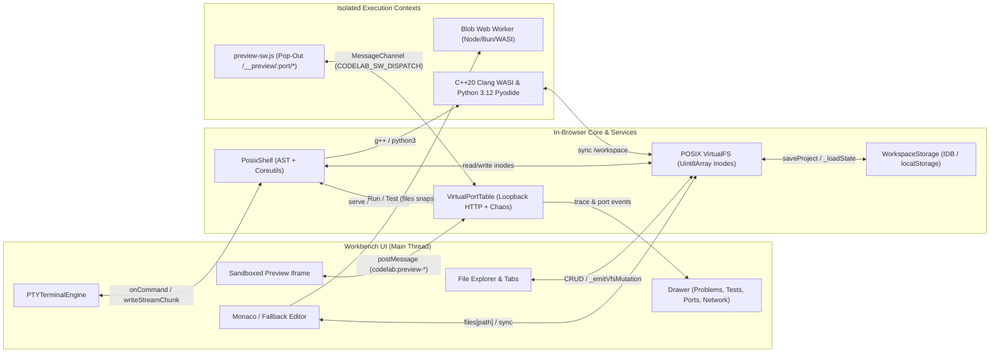

# Codebase Map (`@innovatorved/code-lab` Pre-Refactor Baseline `v0.3.2`)

> **Phase 0 Full-Repo Map** — Produced after reading all 35 source files (~44,000 LOC in `src/`), `tools/bundle.js` (1,505 LOC), `tools/lint.js` (111 LOC), `examples/`, and `tests/` (43 Node/Bun suites + 7 Playwright specs).

---

## 1. Repository Folder Tree

```text
code-lab/
├── .github/
│   ├── dependabot.yml
│   └── workflows/ci.yml                 # Bun 1.4.3 + Node {20,22,24} + Playwright {chromium,firefox,webkit}
├── ARCHITECTURE.md                      # Pre-refactor architecture overview
├── CHANGELOG.md                         # Release history through v0.3.2
├── CONTRIBUTING.md                      # Contributor workflow & invariants
├── LICENSE                              # MIT License
├── README.md                            # Package overview & usage docs
├── SECURITY.md                          # Threat model & CSP documentation
├── package.json                         # @innovatorved/code-lab v0.3.2 (packageManager: bun@1.4.3)
├── playwright.config.ts                 # Playwright browser test config (http://127.0.0.1:4173)
├── tsconfig.json                        # Loose declaration emit (strict: false)
├── tsconfig.strict.json                 # Strict allowlist (12 leaf modules)
├── tools/
│   ├── bundle.js                        # 1,505 LOC raw string concatenator + esbuild hybrid bundler
│   └── lint.js                          # 111 LOC AST/regex linter (no empty catch, @ts-nocheck allowlist)
├── src/
│   ├── index.ts                         # 129 LOC root barrel re-export
│   ├── code-lab.css                     # 5,572 LOC workbench stylesheet & CSS custom properties
│   ├── csp.ts                           # 590 LOC [strict] Web Preview CSP builder & iframe shims
│   ├── diagnostics.ts                   # 155 LOC [strict] DiagnosticsStore
│   ├── html.ts                          # 88 LOC  [strict] SafeHtml tagged template & HTML escaping
│   ├── logger.ts                        # 139 LOC [strict] Leveled logger & CodeLabError
│   ├── preview-sw.js                    # 255 LOC Service Worker virtual HTTP loopback proxy
│   ├── runtime.ts                       # 9,805 LOC [@ts-nocheck] Virtual Node/Bun/WASI runtime + Worker host
│   ├── runtime/
│   │   ├── index.ts                     # 5 LOC barrel
│   │   └── test-harness.ts              # 57 LOC standalone test stdout parser (unimported by runtime.ts)
│   ├── sample.html                      # 304 LOC standalone HTML demo
│   ├── schemas.ts                       # 357 LOC [strict] Zod schemas & inferred types
│   ├── scm.ts                           # 355 LOC [strict] Pure-TS Git status/stage/commit engine
│   ├── search.ts                        # 433 LOC [strict] Multi-file regex/glob search & replace
│   ├── shell.ts                         # 8,767 LOC [@ts-nocheck] POSIX shell AST, 66 coreutils, npm, git, serve
│   ├── shell/
│   │   ├── index.ts                     # 5 LOC barrel
│   │   └── coreutils/compilers-cli.ts   # 103 LOC dead/drifted Python CLI stub (unimported by shell.ts)
│   ├── storage.ts                       # 377 LOC [strict] IndexedDB -> localStorage -> Memory storage
│   ├── terminal.ts                      # 1,206 LOC [@ts-nocheck] PTY terminal UI & ANSI/VT100 parser
│   ├── workbench.ts                     # 10,088 LOC [@ts-nocheck] Monolithic IDE Workbench & <code-lab> element
│   ├── workbench/                       # Partial extraction (7 of 10 files disconnected from workbench.ts!)
│   │   ├── index.ts                     # 38 LOC barrel bundled as CodeLabWorkbenchComponents
│   │   ├── command-palette.ts           # 140 LOC [unused duplicate]
│   │   ├── diff-editor.ts               # 244 LOC [partially used: CodeLabDiffEditorManager]
│   │   ├── drawer.ts                    # 157 LOC [unused duplicate]
│   │   ├── editor.ts                    # 49 LOC  [partially used: formatCppSource]
│   │   ├── file-tree.ts                 # 51 LOC  [unused duplicate]
│   │   ├── guided-pane.ts               # 43 LOC  [unused duplicate]
│   │   ├── icons.ts                     # 48 LOC  [strict, unused duplicate]
│   │   ├── share.ts                     # 128 LOC [strict, used: #codelab= URL compression]
│   │   ├── styles.ts                    # 201 LOC [unused duplicate of code-lab.css tail]
│   │   └── toolbar.ts                   # 182 LOC [unused duplicate]
│   ├── zip.ts                           # 348 LOC [strict] PKZip v2.0 Store encoder/decoder
│   └── extensions/
│       ├── cpp.ts                       # 2,080 LOC WASI Clang/LLVM C++20 toolchain + Monaco service
│       ├── python.ts                    # 1,305 LOC Pyodide CPython 3.12 toolchain + Monaco service
│       ├── javascript.ts                # 54 LOC Monaco JS language configuration
│       ├── typescript.ts                # 85 LOC Monaco TS language configuration
│       └── guided-lab.ts                # 64 LOC Guided walkthrough stepper extension
├── examples/
│   ├── index.html                       # Guided Token Bucket HTML demo
│   └── cloud-ide/                       # Astro static Cloud IDE & GitHub repo cloner app
└── tests/
    ├── run-all.js                       # Sequential runner for 43 Node/Bun suites against dist/
    ├── helpers/                         # load.js, globals.js, mock-dom.js, modules.js
    ├── test-*.js                        # 42 unit, integration, security, adversarial & invariant suites
    ├── e2e/                             # 4-tier virtual-DOM E2E suite (98 tests)
    └── browser/                         # 7 Playwright Chromium/Firefox/WebKit real-browser specs
```

---

## 2. Module Responsibilities & Line-Range Breakdown

### 2.1 Strict Leaf Modules (`tsconfig.strict.json` — 12 files)
| Module | Lines | Responsibility |
| :--- | ---: | :--- |
| [csp.ts](file:///Users/vedgupta/Desktop/code-lab/src/csp.ts) | 590 | Builds preview `Content-Security-Policy` (`strict` / `balanced` / `custom`) and `buildPreviewShims()` (in-memory storage shims, CSP violation reporter, console forwarding, runtime error overlay, `fetch`/click/`history` loopback bridge). |
| [storage.ts](file:///Users/vedgupta/Desktop/code-lab/src/storage.ts) | 377 | `WorkspaceStorage` cascading persistence (`indexeddb` → `localstorage` → `memory`) with quota downgrade. |
| [schemas.ts](file:///Users/vedgupta/Desktop/code-lab/src/schemas.ts) | 357 | Zod schemas (`WorkbenchOptionsSchema`, `RuntimeExecuteOptionsSchema`, `GuidedLabExtensionOptionsSchema`, etc.). |
| [scm.ts](file:///Users/vedgupta/Desktop/code-lab/src/scm.ts) | 355 | Pure-TS Git working-tree diff, `stageFile`, `unstageFile`, `commitChanges`, `computeShortCommitHash`. |
| [zip.ts](file:///Users/vedgupta/Desktop/code-lab/src/zip.ts) | 348 | Zero-dependency PKZip 2.0 `createZip` / `extractZip` with CRC32 & Zip-Slip path sanitization. |
| [search.ts](file:///Users/vedgupta/Desktop/code-lab/src/search.ts) | 433 | Multi-file `searchInFiles` / `replaceInFiles` with regex, whole-word, case-sensitivity, and glob filters. |
| [diagnostics.ts](file:///Users/vedgupta/Desktop/code-lab/src/diagnostics.ts) | 155 | Batched reactive `DiagnosticsStore` (`add`, `setMany`, `clear`, `subscribe`). |
| [logger.ts](file:///Users/vedgupta/Desktop/code-lab/src/logger.ts) | 139 | Leveled `createLogger` + typed `CodeLabError` (`E_SAVE`, `E_RUNTIME`, `E_PREVIEW`, `E_CONFIG`, etc.). |
| [html.ts](file:///Users/vedgupta/Desktop/code-lab/src/html.ts) | 88 | Branded `SafeHtml` tagged template `html` + `escapeHtml` + `raw`. |
| [share.ts](file:///Users/vedgupta/Desktop/code-lab/src/workbench/share.ts) | 128 | `CompressionStream('deflate-raw')` Base64url `#codelab=` URL snapshot codec (5 MB decompression cap). |
| [icons.ts](file:///Users/vedgupta/Desktop/code-lab/src/workbench/icons.ts) | 48 | SVG icon map (currently shadowed by inline copy in `workbench.ts:1215`). |
| [guided-pane.ts](file:///Users/vedgupta/Desktop/code-lab/src/workbench/guided-pane.ts) | 43 | Step pills HTML renderer (currently shadowed by `_renderStepPills` in `workbench.ts:2854`). |

### 2.2 Monolithic `@ts-nocheck` Core Subsystems (4 files — 29,866 LOC)

1. **[runtime.ts](file:///Users/vedgupta/Desktop/code-lab/src/runtime.ts) (9,805 LOC)**:
   - `L22–9474`: Single `function __initVirtualRuntime(rootScope)` serialized via `.toString()` for Web Worker execution:
     - `L22–891`: `VirtualBuffer`, `VirtualCrypto` (MD5/SHA-1/SHA-256/HMAC), `VirtualZlib`.
     - `L894–1861`: `VirtualPath`, `VirtualOs`, `createVirtualFs` (in-memory `Uint8Array` inodes, fd table, sync + `fs/promises` + streams).
     - `L1864–4278`: `EventEmitter`, `url`, `querystring`, `stream`, `createVirtualPortTable` (with Chaos fault rules), `createVirtualHttp`, `assert`, `util`, `dns`, `createVirtualNet`.
     - `L4281–5305`: Custom JSX/TSX transform, `transpileTS` (TS stripper + ESM→CJS or `keepEsm`), `instrumentTestCode`.
     - `L5308–6141`: `preloadNpmPackages` (jsDelivr loader), `createVirtualWasi` (`wasi_snapshot_preview1`), `executeWasiModule`.
     - `L6143–8801`: `executeInVirtualRuntime` (50 Node built-in modules, `Bun.*`, `node:test`, `bun:test`, CJS `require` loader, `.wasm`/`.cpp`/`.py` compiler dispatch, 2ms idle event-loop drain).
     - `L8811–9444`: `createSqliteDatabase` (`bun:sqlite` persisted as JSON in VFS).
   - `L9476–9760`: `__workerMessageLoop`, `createWorkerRuntimeSource`, warm Web Worker pool (`executeInWorker`).

2. **[shell.ts](file:///Users/vedgupta/Desktop/code-lab/src/shell.ts) (8,767 LOC)**:
   - `L104–1588`: `PosixPath`, glob/brace/`$((...))` arithmetic expanders, `tokenizeShell`, recursive-descent `parseShellCommand`.
   - `L1883–2924`: Public GitHub repository cloner (`cloneGitHubRepository` via GitHub Trees API + jsDelivr fallback) and multi-CDN `npm`/`pnpm`/`bun` package installer (`installPackage`).
   - `L2935–3454`: Built-in `serve` browser ESM dev server (`registerPreviewServer`, import-map generator, Vite/Next/Astro dev-script fallback).
   - `L3506–7660`: `COREUTILS` map (66 built-in commands: POSIX file/text utilities, `git`, `node`, `bun`, `npm`, `g++`, `python3`, `pytest`, `pip`, `curl`, `hey`, `chaos`, `sqlite3`, `redis-cli`, etc.).
   - `L7665–8734`: `PosixShell` AST interpreter, pipelines, I/O redirections, background job table (`&`, `jobs`, `kill`).

3. **[terminal.ts](file:///Users/vedgupta/Desktop/code-lab/src/terminal.ts) (1,206 LOC)**:
   - `L46–304`: SGR 16/256/TrueColor ANSI escape sequence parser (`ansiToHtml`) and control-code resolver (`\r`, `\b`, CSI `K`/`2J`).
   - `L314–1172`: `PTYTerminalEngine` (streaming row buffer, foreground lock `isBusy`, `readLine()` prompt queue, history, `Ctrl+R` reverse search, `Tab` completion).

4. **[workbench.ts](file:///Users/vedgupta/Desktop/code-lab/src/workbench.ts) (10,088 LOC)**:
   - `L63–1106`: Inline `NODE_AMBIENT_DTS`, GFM Markdown renderer, Monaco AMD loader & custom dark/light themes.
   - `L1380–9851`: `CodeLabWorkbench` (~112 methods handling layout, Explorer CRUD, editor tabs, Monaco + `<textarea>` fallback, Guided Walkthrough, 8 bottom drawer tabs, dual-dock Web Preview + Service Worker bridge, Search/SCM/Diff/Share/Packages/Clone modals, and `localStorage` + `IndexedDB` persistence).
   - `L9854–10068`: `<code-lab>` Custom Element (`CodeLabElement`) and `window.CodeLab` global SDK.

---

## 3. End-to-End Data Flow



---

## 4. Entry Points

| Entry Point | Source | Built Artifact | Consumers |
| :--- | :--- | :--- | :--- |
| Root SDK & `<code-lab>` | `src/index.ts` + `src/workbench.ts` | `dist/code-lab.{js,esm.js,d.ts}` | `<script>`, `import CodeLab from '@innovatorved/code-lab'`, `<code-lab>` Web Component |
| Headless Runtime | `src/runtime.ts` | `dist/runtime.{js,esm.js,d.ts}` | `@innovatorved/code-lab/runtime` (`executeInWorker`, `executeInVirtualRuntime`, `createVirtualFs`) |
| Standalone Shell | `src/shell.ts` | `dist/shell.{js,esm.js,d.ts}` | `@innovatorved/code-lab/shell` (`createPosixShell`, `cloneGitHubRepository`) |
| Standalone Terminal | `src/terminal.ts` | `dist/terminal.{js,esm.js,d.ts}` | `@innovatorved/code-lab/terminal` (`PTYTerminalEngine`, `ansiToHtml`) |
| Zod Schemas | `src/schemas.ts` | `dist/schemas.{js,esm.js,d.ts}` | `@innovatorved/code-lab/schemas` |
| Extensions (5) | `src/extensions/*.ts` | `dist/extensions/*.{js,esm.js,d.ts}` | `@innovatorved/code-lab/extensions/{guided-lab,javascript,typescript,cpp,python}` |
| Preview Service Worker | `src/csp.ts` + `src/preview-sw.js` | `dist/preview-sw.js` | Browser `navigator.serviceWorker.register('/preview-sw.js')` |
| Stylesheet | `src/code-lab.css` | `dist/code-lab.css` | `@innovatorved/code-lab/css` |

---

## 5. Global Mutable State & Hidden / Circular Dependencies

### 5.1 Global Namespace Mutations (`globalThis` / `window`)
- `runtime.ts`: Mutates `globalThis.Bun` on import (`L3`), `window.CodeLabRuntime`, `window.VirtualNodeRuntime` (`L9513–9520`).
- `shell.ts`: Attaches **9 bare globals** onto `window` (`CodeLabShell`, `createPosixShell`, `PosixShell`, `parseShellCommand`, `tokenizeShell`, `COREUTILS`, `createVirtualPortTable`, `parseGitHubRepoUrl`, `cloneGitHubRepository` at `L30–38`).
- `terminal.ts`: Attaches **6 bare globals** onto `window` (`CodeLabTerminal`, `PTYTerminalEngine`, `createPTYTerminalEngine`, `createTerminal`, `ansiToHtml`, `parseAnsiToHtml` at `L20–27`).
- `extensions/cpp.ts` & `extensions/python.ts`: Mutate singleton `globalThis.__codelabCppCompiler` (`cpp.ts:1286`) and `globalThis.__codelabPythonCompiler` (`python.ts:1158`).
- `workbench.ts`: Reads ambient host globals `IMPLEMENTATIONS_DATA` and `GUIDED_LABS_DATA` (`L1420–1421`), sets `window.MonacoEnvironment` (`L980`), and mounts `window.CodeLab` (`L10055`).

### 5.2 Module-Scoped Mutable Singletons
- `runtime.ts`: `_activeCwdGetter` (`L896` — overwritten per run!), `_defaultPortTable` (`L2764`), `_npmPackageCache` & `_npmMetadataCache` (`L5319–5320`), `_cachedWorkerUrl`, `_warmWorker`, `_warmWorkerBusy`, `_activeWorkerJobs` (`L9522–9525`).
- `workbench.ts`: `_monacoLoadPromise` (`L970`), `_codeLabInstanceCounter` (`L1260`), `_fallbackStorage` (`L1261`).
- `preview-sw.js`: `configuredCsp` (`L27` — single string shared across all browser tabs).

### 5.3 Circular & Hidden Runtime Couplings
1. **`runtime.ts` ↔ `extensions/{cpp,python}.ts` Implicit Global Cycle**:
   - `extensions/cpp.ts` calls `globalThis.CodeLabRuntime.executeWasiModule` (`cpp.ts:548`), while `runtime.ts` reaches back out to `globalThis.__codelabCppCompiler` (`runtime.ts:8635`) and `globalThis.__codelabPythonCompiler` (`runtime.ts:8686`).
2. **`shell.ts` ↔ `runtime.ts` Implicit Global Lookup**:
   - `shell.ts` resolves `globalThis.CodeLabRuntime` dynamically (`getRuntimeModule()`, `shell.ts:57`) rather than accepting a typed `IRuntimeService` interface via dependency injection.
3. **Bundler Raw-Source Slicing Coupling (`tools/bundle.js:43–51`)**:
   - `tools/bundle.js` slices `runtime.ts`, `shell.ts`, `terminal.ts`, and `workbench.ts` at the magic comment `// ── TypeScript module surface` and concatenates them **without TypeScript transpilation**, coupling file layout comments directly to browser runtime validity.
4. **Disconnected Shadow Extractions (`src/workbench/*`, `src/runtime/*`, `src/shell/*`)**:
   - 7 files in `src/workbench/`, `src/runtime/test-harness.ts`, and `src/shell/coreutils/compilers-cli.ts` exist on disk and are even bundled into `dist/`, yet the monolithic `workbench.ts`, `runtime.ts`, and `shell.ts` files still execute their own inline copies!
